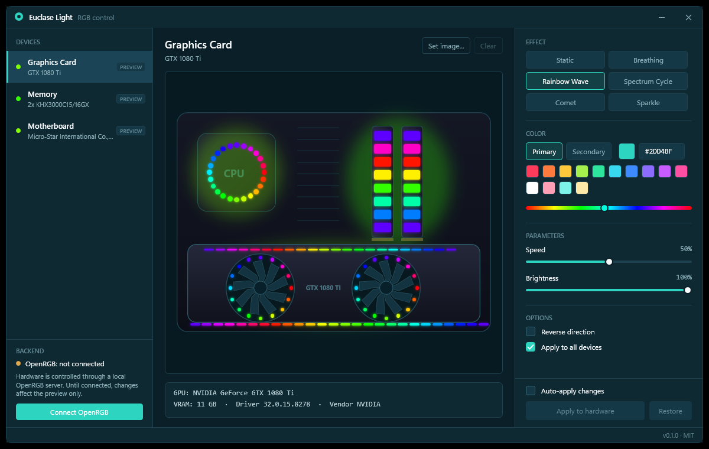
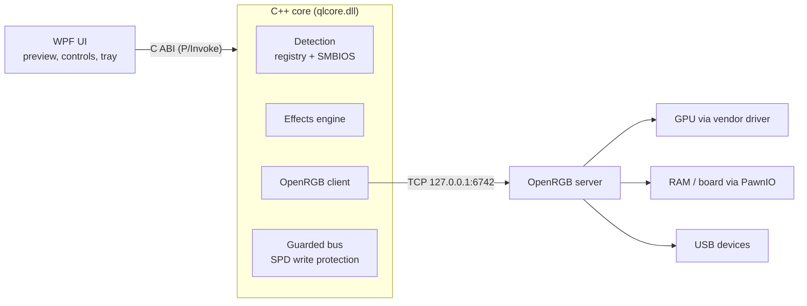

# Euclase Light

Control panel for RGB lighting on Windows: graphics card, RAM, motherboard and any other device supported by [OpenRGB](https://openrgb.org). C++17 core with a WPF front end.




## Overview

Each hardware vendor ships its own RGB suite, and the suites compete for the same buses. Euclase Light is a single small application that:

- detects the GPU (name, VRAM, driver), RAM modules (slot, manufacturer, part number, speed) and the motherboard, without installing a driver;
- renders a live preview of the selected effect;
- sends the effect to the real hardware through the OpenRGB SDK server, and shows a **LIVE** or **PREVIEW** badge on every device.

Euclase Light does not implement device protocols itself. Hardware support is exactly the hardware support of OpenRGB.

### Features

- Six effects computed by the C++ engine: Static, Breathing, Rainbow Wave, Spectrum Cycle, Comet, Sparkle. Colour, speed, brightness and direction are adjustable.
- Any other device exposed by OpenRGB (keyboards, mice, LED strips, coolers) appears as its own card.
- A custom photo can be assigned to each device.
- *Restore* returns the device to the mode it had before Euclase Light changed it.
- Memory and motherboard buses are accessed only through OpenRGB, behind a write-protection layer for SPD addresses (see [Safe bus scanning](docs/SAFE_SCANNING.md)).
- Tray icon, single instance, settings in `%APPDATA%\EuclaseLight\settings.json`, no telemetry.

## Installation

1. Download `EuclaseLight-<version>-win-x64.zip` from [Releases](../../releases) and unpack it. A .NET installation is not required.
2. Start `EuclaseLight.exe` and accept the UAC prompt (required for RAM and motherboard access).
3. Press **Connect OpenRGB**. If OpenRGB is not installed, Euclase Light offers to download the official release and verifies its pinned SHA-256 checksum before use.
4. RAM and motherboard only: install the free **PawnIO** driver from [pawnio.eu](https://pawnio.eu) and stop other RGB software (see below).
5. Choose an effect and press **Apply to hardware**, or enable *Auto-apply changes*.

Graphics cards and USB devices work without PawnIO and without administrator rights.

The release is not code-signed yet. Windows SmartScreen may warn about an unknown publisher; verify the SHA-256 on the release page or build from source.

## Troubleshooting

| Symptom | Cause and remedy |
|---|---|
| RAM or motherboard is missing, or does not change | 1) Install PawnIO and restart Euclase Light. 2) Run as administrator. 3) Stop other RGB software that holds the same bus (next row). |
| MSI Center / Mystic Light is installed | Closing its window is not enough. Exit it from the tray and stop its services in `services.msc`: `Mystic_Light_Service`, `MSI_Central_Service`. The same applies to Armoury Crate / Aura, iCUE, Razer Synapse, NZXT CAM, SignalRGB, Gigabyte RGB Fusion / Aorus Engine, HyperX NGENUITY and Corsair / Kingston tools. Two programs on one bus cause missing devices and flicker. |
| GPU is not listed or does not change | Close vendor GPU RGB tools (Aorus Engine, Afterburner RGB, ROG GPU Tweak). Check the card against the OpenRGB supported-devices list. Update the graphics driver. |
| "Connect OpenRGB" cannot connect | Another `OpenRGB.exe` may be running with different settings; end it and retry. The OpenRGB SDK server must listen on `127.0.0.1:6742`. |
| Antivirus flags the program | Hardware-access drivers and RGB tools are commonly reported as false positives. Review the source or build it yourself. |
| Effect differs on the device | Devices use their built-in modes. If a mode is missing (for example Comet), Euclase Light shows the primary colour statically and reports it in the status bar. |
| Colour resets after reboot | Many devices do not store a static colour. Re-apply after boot; autostart is on the roadmap. |
| Still failing | Check the OpenRGB log in `%APPDATA%\OpenRGB\logs`. `Permission Denied` means the process is not elevated; `Could not open PawnIO` means the driver is missing. Then [open an issue](../../issues) with the log and your GPU, RAM and board models. |

## Status

| Area | State |
|---|---|
| Detection of GPU, RAM and motherboard | Implemented; tested on one PC (author's) |
| C++ core: effects, OpenRGB protocol, bus-safety layer | 46 automated checks |
| OpenRGB 1.1 SDK client (protocol 3) | Verified against a live server |
| Gigabyte GTX 1080 Ti Xtreme (no extra driver) | Verified on the author's PC |
| HyperX Predator RGB RAM and MSI MPG Z390 Gaming Plus (with PawnIO) | Working on one PC; not tested elsewhere |
| Other hardware | Expected to work if OpenRGB supports it; reports welcome |
| Autostart, profiles, per-LED editor | Roadmap |

## Architecture



Details: [Architecture](docs/ARCHITECTURE.md), [Safe bus scanning](docs/SAFE_SCANNING.md).

Security-relevant decisions: the OpenRGB download is pinned to a fixed release and SHA-256 and extracted with a path-traversal guard; the OpenRGB connection is loopback only; writes to protected SPD address ranges are blocked unless explicitly granted. See [SECURITY.md](SECURITY.md).

## Build from source

Requirements: Windows x64, MSYS2 mingw64 `g++`, .NET SDK 10.

```powershell
./package.ps1                     # core, tests, dist/EuclaseLight-<version>-win-x64.zip
```

Development run (no UAC prompt, so GPU and USB devices only):

```powershell
./build-core.ps1
cd ui/EuclaseLight.App
dotnet build -c Release -p:Platform=x64
./bin/x64/Release/net10.0-windows/EuclaseLight.exe --no-elevate
```

CI builds the C++ core and runs its test suite on every push.

## Roadmap

Autostart and tray-only mode, profiles, per-LED editor, native plugins for devices OpenRGB does not cover, low-memory background service, code signing.

## Краткое описание

Euclase Light показывает видеокарту, память и материнскую плату, рисует превью подсветки и управляет реальным железом через OpenRGB. Установка: скачать zip из Releases, запустить `EuclaseLight.exe` с правами администратора, нажать «Connect OpenRGB» (при необходимости приложение скачает OpenRGB и проверит хэш). Для памяти и платы нужен драйвер PawnIO. Если не работает: остановите службы других RGB-программ (MSI Center / Mystic Light, Armoury Crate, iCUE, Synapse, SignalRGB и т. д.) и запустите от администратора. Видеокарты и USB-устройства работают без PawnIO и без прав администратора.

## Contributing and licensing

See [CONTRIBUTING.md](CONTRIBUTING.md). MIT license. [OpenRGB](https://openrgb.org) is GPL-2.0 and is used only as a separate process; PawnIO is a separate driver by its authors.
